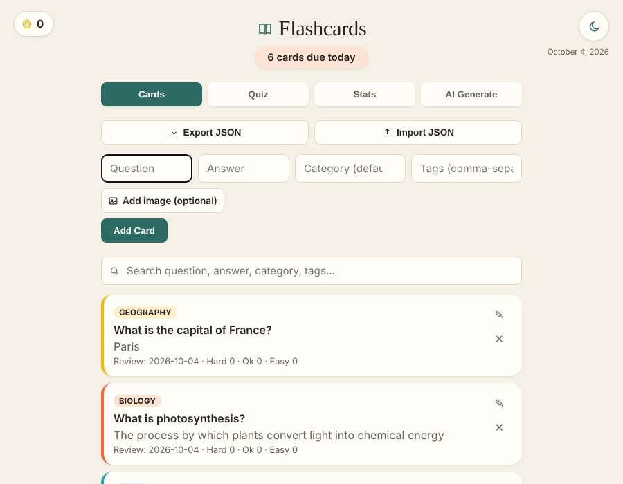

# Flashcards

A single-file spaced-repetition flashcards app, built with plain HTML, CSS, and JavaScript — no frameworks, no build step, no backend.

**[Live demo →](https://flashcards-bedce5.netlify.app/)**



## Why this exists

Most flashcard apps either lock your data behind an account, or are over-engineered for what is fundamentally a simple problem: show a question, hide the answer, let the learner grade their own recall, and use that grade to decide when to show the card again. This project is an exercise in building that loop well — a real spaced-repetition scheduler, a thoughtful visual design, and a few small ideas (hint-buying with earned coins, AI-assisted card generation) layered on top without compromising the core mechanic.

Everything lives in **one HTML file**. There is nothing to install and nothing to configure — open `index.html` in a browser and the app runs.

## Features

- **Spaced repetition scheduling.** A simplified SM-2–style algorithm adjusts each card's review interval based on whether you grade it Hard, Ok, or Easy. Cards you find difficult come back sooner; cards you know well come back less often.
- **Categories, tags, and search.** Organize cards freely — categories get a deterministic color so the same category always renders in the same color, with no extra data stored per card.
- **Optional images per card.** Images are resized and compressed client-side before being saved, so a handful of photos don't blow through the browser's local storage quota.
- **Two quiz modes.** "Due today" respects the spaced-repetition schedule; "All cards" is a free-practice mode for exam-cramming that doesn't touch your long-term schedule unfairly (see *Design notes* below).
- **Coins & hints.** Grading a card correctly earns coins, which can be spent on three progressively more revealing hints before you give up and look at the answer. It's a small nudge toward active recall instead of passive flipping.
- **Stats.** See your best- and worst-known cards and your success rate per category, computed from your own grading history — no hidden scoring.
- **AI card generation (bring your own API key).** Paste text, or drop a `.pdf`/`.txt`/`.md` file, and generate a batch of question/answer pairs with Claude. Nothing is added to your deck until you review and confirm each card. Your API key is stored only in your browser's local storage and is never included in exports.
- **Import / export.** Your full deck (and coin balance) exports to a single JSON file you can back up or move between devices.
- **Light and dark mode**, following your system preference by default, with a manual override.
- **Fully local.** Everything — cards, images, settings, coins, your API key — stays in the browser's local storage. There is no server and no account.

## Getting started

No installation required.

```
git clone <this-repo>
cd flashcards
open index.html   # or just double-click it
```

That's it. To use the AI card generation feature, you'll need your own [Anthropic API key](https://console.anthropic.com/), entered once in the "AI Generate" tab.

### Deploying

Because it's a single static HTML file, this deploys anywhere that serves static files. The included `netlify.toml` makes a Netlify deploy a one-click affair (drag the folder into Netlify, or connect the repo).

## Tech stack

- **HTML5 / CSS3 / vanilla JavaScript (ES6+)** — no frameworks, no libraries, no bundler.
- **LocalStorage** as the only persistence layer.
- **Anthropic Claude API**, called directly from the browser for the optional AI-generation feature (bring-your-own-key).

This was a deliberate constraint, not a limitation I hit by accident: building the scheduling algorithm, the data model, and the UI state management by hand — without reaching for a framework — was the point of the exercise.

## Design notes

A few decisions worth calling out, for anyone skimming this as a portfolio piece:

- **The category color palette is deterministic, not stored.** Each category's color is derived from a hash of its name, computed at render time. This means the data model never has to store or migrate a "color" field, and two devices with the same categories always render them identically.
- **The spaced-repetition answer is never in the DOM before you ask for it.** Clicking "Show Answer" is what writes the answer into the page — it isn't just hidden with CSS beforehand. This was a conscious choice so the quiz can't be "cheated" by inspecting the page before you've committed to an answer. The one deliberate, documented exception is the hint system: a hint is derived from the answer and rendered in a separate element, but it's never a 100% reveal.
- **"All cards" practice mode has an anti-farming rule.** Free practice intentionally doesn't touch your spaced-repetition schedule the same way a "due" review does, and a card only earns coins once per calendar day in that mode — otherwise you could regrade the same card in a loop for infinite coins.
- **The color system passes WCAG AA contrast** in both light and dark mode, verified by calculation rather than by eye. Button backgrounds and button text intentionally use separate CSS variables, because no single color satisfies both "readable as text" and "readable as a button background" at the same time.

## Project structure

```
index.html       — the entire application
netlify.toml      — Netlify deploy configuration
LICENSE
README.md
```

## License

MIT — see [LICENSE](LICENSE).
